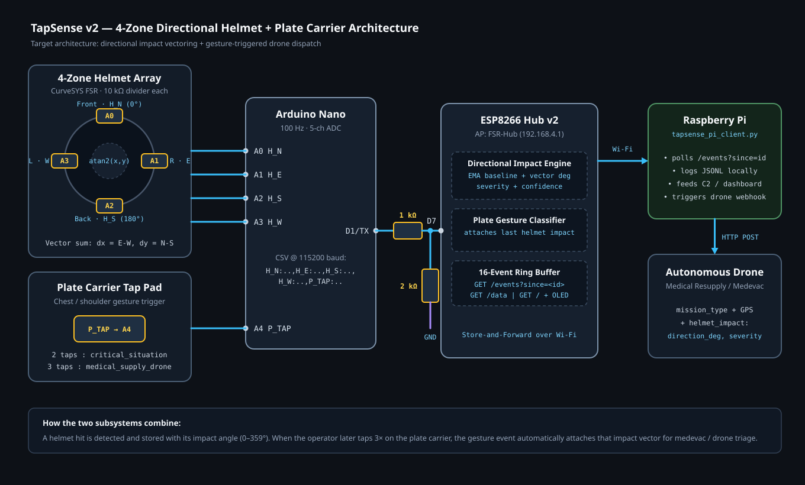

# TapSense — Gesture-Triggered Tactical Resupply

**2nd place · European Defense Tech Hackathon · UniBw München · 6–9 November 2026**

When a soldier is pinned down or injured, reaching for a radio or a tactical device
is not always an option. TapSense turns a physical gesture on the gear itself into an
automatic request: tap the sensor pad, and the system dispatches an autonomous medical
supply drone or calls a medevac unit — with helmet impact data attached to the location.

This repository covers **the sensing and embedded communication stack**, from the
CurveSYS force sensors through the microcontroller nodes up to the Raspberry Pi.

---

## System overview

### 1. Stage Demo (v1 — ran live at EDTH)

```
  CurveSYS force sensor (FSR)
            │  analog (A0/A1/A2)
            ▼
  Arduino Nano          samples zones at 50 Hz, emits labelled CSV @ 115200
            │  UART (5 V → 3.3 V divider)
            ▼
  ESP8266 Hub           own Wi-Fi AP ("FSR-Hub"), parses stream, serves HTTP + OLED
            │  Wi-Fi (192.168.4.1)
            ▼
  Raspberry Pi          joins AP, polls /data, forwards to drone / C2
```


Each hop has a single responsibility: the Nano only samples, the ESP8266 only parses
and serves, and the Pi handles mission dispatch. Keeping the nodes decoupled made it
fast to iterate and debug under hackathon constraints.

### 2. Target Architecture (v2 — 4-Zone Directional Helmet + Plate Carrier)



The full target implementation in [`firmware/v2_helmet_plate/`](firmware/v2_helmet_plate/)
extends the demo chain to two combined wearables:

- **4-Zone Helmet Array (`A0`–`A3`):** orthogonal CurveSYS FSR zones (`N / E / S / W` at
  0°, 90°, 180°, 270°) sampled at **100 Hz**. Adaptive EMA baseline tracking filters
  slow strap tension and leaning, while sharp impacts compute a vector angle (`0–359°`),
  cardinal direction, severity (`LOW` / `MEDIUM` / `HIGH`), and confidence score.
- **Plate Carrier Tap Pad (`A4`):** chest/shoulder gesture trigger classifying 2, 3, or 4
  taps (`critical_situation`, `medical_supply_drone_request`, `backup_resupply_request`).
  Every gesture event automatically attaches the latest helmet impact vector.
- **Unresponsive Auto-Medevac Escalation:** if a `HIGH`-severity helmet hit is not
  acknowledged by any plate tap within 10 seconds, the ESP8266 automatically emits an
  `auto_medevac_unresponsive` dispatch event with the impact direction and force.
- **Store-and-Forward Ring Buffer (`GET /events?since=<id>`):** 16-slot event queue on
  the ESP8266 so the Raspberry Pi consumer (`pi/tapsense_pi_client.py`) recovers missed
  events after temporary Wi-Fi dropouts.
- **Interactive Browser Simulator (`tools/sim_v2_hub.py`):** mirrors the exact v2 HTTP
  contract (`/`, `/data`, `/events`) locally so anyone can trigger impacts, taps, and
  auto-medevac escalation right in the browser without hardware connected.

---

## Repository layout

| Path | What |
|---|---|
| `firmware/nano_fsr_3zone/` | **v1 Demo:** Arduino Nano 3-zone FSR sampling, labelled CSV output |
| `firmware/esp8266_hub/` | **v1 Demo:** ESP8266 AP, serial parser, HTTP `/data`, OLED UI |
| `firmware/v2_helmet_plate/` | **v2 Target:** 4-zone directional helmet + plate carrier firmware (Nano + ESP8266) |
| `pi/` | Raspberry Pi consumer (`tapsense_pi_client.py`), WebSocket bridge, dashboards, Wi-Fi config |
| `tools/` | Host-side plotters, monitors, `flash.sh`, and schematic generators |
| `docs/wiring/` | SVG + HTML wiring schematics (`tapsense-system.*`, `tapsense-helmet-plate.*`) |
| `docs/PROTOCOL.md` | Wire formats, v1/v2 HTTP endpoints, and event schemas |
| `docs/ARCHITECTURE.md` | Hardware design decisions and latency/bandwidth budget |
| `archive/helmet-track/` | Early CurveSYS helmet-impact prototype & signal processing reference |

---

## Hardware

| Board | Role | Notes |
|---|---|---|
| Arduino Nano (ATmega328P) | Sensor readout | 3–5 analog channels (`A0`–`A4`), 10 kΩ pulldown per zone |
| ESP8266 (NodeMCU / Ideaspark) | Wi-Fi hub | Built-in SSD1306 OLED (`D5`/`D6`), Nano RX on `D7` (GPIO13) |
| Raspberry Pi | Base / C2 relay | Joins `FSR-Hub`, runs `tapsense_pi_client.py` |
| CurveSYS multi-zone FSR | Sensing element | Flexible force/deflection film, analog voltage-divider readout |

**Voltage divider (mandatory):** each FSR sits in a `5 V → FSR → Ax → 10 kΩ → GND`
divider. Nano `D1/TX` (5 V logic) connects to ESP `D7` (3.3 V logic) through a
**1 kΩ / 2 kΩ resistor divider** with a shared ground rail.

Regenerate the schematics anytime with:

```bash
python3 tools/gen_schematic.py
python3 tools/gen_schematic_v2.py
```

---

## Flashing & running

Install `arduino-cli`, then compile and upload either v1 (stage demo) or v2 (helmet + plate):

```bash
# Nano (v2 5-channel helmet + plate)
arduino-cli core install arduino:avr
arduino-cli compile --fqbn arduino:avr:nano firmware/v2_helmet_plate/nano_helmet_plate
arduino-cli upload  --fqbn arduino:avr:nano --port /dev/ttyUSB0 firmware/v2_helmet_plate/nano_helmet_plate

# ESP8266 Hub (v2)
arduino-cli config add board_manager.additional_urls \
  https://arduino.esp8266.com/stable/package_esp8266com_index.json
arduino-cli core install esp8266:esp8266
arduino-cli lib install U8g2
arduino-cli compile --fqbn esp8266:esp8266:nodemcuv2 firmware/v2_helmet_plate/esp8266_helmet_plate_hub
arduino-cli upload  --fqbn esp8266:esp8266:nodemcuv2 --port /dev/ttyUSB1 firmware/v2_helmet_plate/esp8266_helmet_plate_hub
```

> Disconnect the Nano TX line while flashing the ESP8266 over USB so the divider does
> not interfere with the serial programmer.

**Interactive v2 browser simulator (no hardware required):**

```bash
python3 tools/sim_v2_hub.py
# open http://127.0.0.1:8080/ and optionally pair with the Pi client:
python3 pi/tapsense_pi_client.py --hub http://127.0.0.1:8080
```

**Raspberry Pi consumer (v2):**

```bash
# Test offline without hardware:
python3 pi/tapsense_pi_client.py --sim

# Run against live ESP8266 hub (after joining Wi-Fi "FSR-Hub" / "fsr-sensor"):
python3 pi/tapsense_pi_client.py --hub http://192.168.4.1 --drone-url http://127.0.0.1:9000/dispatch
```

---

## Host-side tooling

| Tool | What it does |
|---|---|
| `tools/sim_v2_hub.py` | Interactive v2 browser simulator (compass, 5-ch waveforms, auto-medevac) |
| `tools/fsr_plotter.py` | matplotlib single-pad plotter, 200-sample rolling window, auto port detect |
| `tools/fsr_status_window.py` | Tkinter window — Zone 1 pressure level + ADC history graph |
| `tools/fsr_onoff.py` | Tkinter ON/OFF trace with threshold line, hot-reconnect |
| `tools/fsr_tui.py` | Terminal live view of the A0 state |
| `tools/fsr_capture_plot.py` | Replays a captured `fsr_raw.log` while it grows |
| `pi/tapsense_pi_client.py` | Store-and-forward `/events` poller + drone dispatch webhook |
| `pi/sensor_monitor.py` | Strict serial monitor — prints `NO_DATA` instead of inventing values |
| `pi/sensor_bridge.py` | Serial → WebSocket bridge on `127.0.0.1:8889` |
| `pi/live_graph.html`, `pi/dashboard.html` | Browser dashboards fed by the bridge |

---

## Demo vs. v2 status

- **v1 (EDTH Stage Demo):** Nano samples FSR channels, ESP8266 brings up the `FSR-Hub`
  AP, serves the live web graph and `/data` (`{"a0":..., "pressed":...}`), and classifies
  2/3/4 taps on the onboard OLED.
- **v2 (`firmware/v2_helmet_plate/` + `pi/tapsense_pi_client.py`):** Full 4-zone
  directional helmet impact detection (`0–359°`), plate-carrier gesture classification,
  16-event store-and-forward ring buffer (`/events?since=<id>`), and automatic impact
  attachment on drone dispatch. *Note: v2 is implemented and syntax-checked; end-to-end
  hardware verification on the 5-channel rig is pending.*

---

## Team

- **Sensing & embedded communication** — Liam Lange & Tanuj Satti
- **Base station & Raspberry Pi dashboard** — Joni Dani
- **Pitch & business** — Emil Kochovski
- **Autonomous drone delivery integration** — Hyunjun Ju

Sensor technology, hardware supply, and on-site support: **CurveSYS**.
Event and venue: **European Defense Tech Hub (EDTH)**, Universität der Bundeswehr München.

---

## License

MIT — see [LICENSE](LICENSE).
