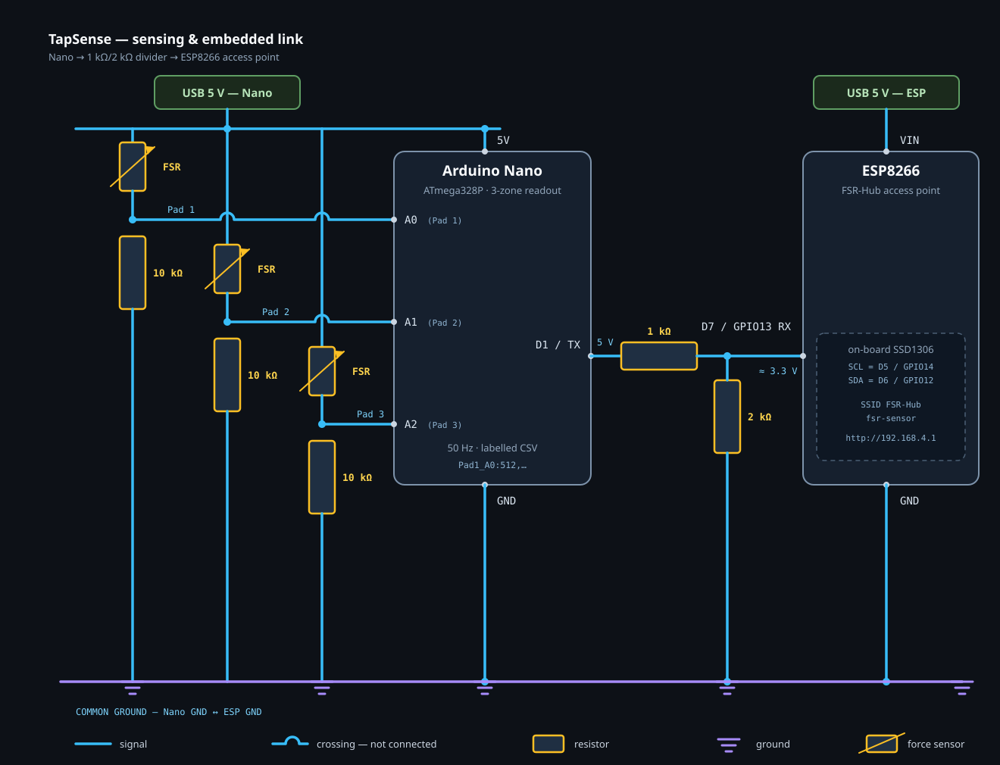

# TapSense — Gesture-Triggered Tactical Resupply

**2nd place · European Defense Tech Hackathon · UniBw München · 6–9 November 2026**

When a soldier is pinned down or injured, reaching for a radio or a tactical device
is not always an option. TapSense turns a physical gesture on the gear itself into an
automatic request: tap the sensor pad, and the system dispatches an autonomous medical
supply drone or calls a medevac unit — with impact data attached to the location.

This repository is **my part of the build**: the sensing and embedded communication
chain, from the force sensor up to the Raspberry Pi dashboard.

---

## The chain

```
  CurveSYS force sensor (FSR)
            │  analog
            ▼
  Arduino Nano          reads 3 zones, emits labelled CSV @ 115200
            │  UART (through a 5 V → 3.3 V divider)
            ▼
  ESP8266 Hub           own Wi-Fi AP, parses the stream, serves HTTP + OLED
            │  Wi-Fi  (SSID "FSR-Hub")
            ▼
  Raspberry Pi          bridge + dashboard, hands events to the drone / C2 side
```



Each hop is deliberately dumb. The Nano only samples. The ESP only parses and serves.
The Pi only decides what an event means. That kept the failure surface small across
three boards in 48 hours.

---

## Repository layout

| Path | What |
|---|---|
| `firmware/nano_fsr_3zone/` | Arduino Nano sketch — 3-zone FSR sampling, labelled CSV output |
| `firmware/esp8266_hub/` | ESP8266 sketch — access point, serial parser, HTTP endpoints, OLED UI |
| `pi/` | Raspberry Pi side — serial→WebSocket bridge, live dashboards, Wi-Fi image config |
| `tools/` | Host-side plotters and monitors (Tkinter, terminal, matplotlib) |
| `docs/wiring/` | Interactive SVG wiring diagrams (open in a browser) |
| `docs/PROTOCOL.md` | Wire formats and the HTTP API |
| `archive/helmet-track/` | Abandoned first approach — CurveSYS helmet impact detection |

---

## Hardware

| Board | Role | Notes |
|---|---|---|
| Arduino Nano (ATmega328P) | Sensor readout | 3 analog zones on A0/A1/A2, 10 kΩ pulldown per zone |
| ESP8266 (NodeMCU, e.g. Ideaspark) | Wi-Fi hub | Built-in SSD1306 OLED on D5/D6, Nano input on D7 |
| Raspberry Pi | Bridge + dashboard | Joins `FSR-Hub`, runs the bridge |
| CurveSYS multi-zone force sensor | Sensing element | Flexible force/deflection film, analog readout |

**Wiring, in one line:** each FSR sits in a voltage divider between 3V3/5V and a 10 kΩ
resistor to GND; the junction goes to the analog pin. Nano `D1/TX` reaches the ESP
`D7` (GPIO13) through a **1 kΩ / 2 kΩ divider** — the Nano drives 5 V and the ESP8266
is 3.3 V only. Never feed 5 V logic straight into the ESP.

The full diagrams live in [`docs/wiring/`](docs/wiring/) — start with
[`tapsense-system.html`](docs/wiring/tapsense-system.html) (or open any HTML file in a
browser), and regenerate the schematic with `python3 tools/gen_schematic.py`.

---

## Flashing

Install `arduino-cli`, then:

```bash
# Nano
arduino-cli core install arduino:avr
arduino-cli compile --fqbn arduino:avr:nano firmware/nano_fsr_3zone
arduino-cli upload  --fqbn arduino:avr:nano --port /dev/ttyUSB0 firmware/nano_fsr_3zone

# ESP8266 (needs the ESP8266 core + U8g2)
arduino-cli config add board_manager.additional_urls \
  https://arduino.esp8266.com/stable/package_esp8266com_index.json
arduino-cli core install esp8266:esp8266
arduino-cli lib install U8g2
arduino-cli compile --fqbn esp8266:esp8266:nodemcuv2 firmware/esp8266_hub
arduino-cli upload  --fqbn esp8266:esp8266:nodemcuv2 --port /dev/ttyUSB1 firmware/esp8266_hub
```

Disconnect the Nano TX line while uploading the ESP — `D7` is shared with the USB
programming path, and the divider fights the programmer otherwise.

**Then, from the Pi (or any laptop):**

```bash
./pi/test_fsr_hub.sh          # joins "FSR-Hub", curls the endpoint
# or by hand:
curl http://192.168.4.1/data   # -> {"a0":512,"pressed":true}
xdg-open http://192.168.4.1/   # live on/off graph
```

Credentials are intentionally committed: `FSR-Hub` / `fsr-sensor`. It is a demo
hotspot with no backhaul — nothing to protect. Change them if you ever reuse this.

---

## Host-side tooling

| Tool | What it does |
|---|---|
| `tools/fsr_plotter.py` | matplotlib single-pad plotter, 200-sample rolling window, auto port detect |
| `tools/fsr_status_window.py` | Tkinter window — Zone 1 pressure level + ADC history graph |
| `tools/fsr_onoff.py` | Tkinter ON/OFF trace with threshold line, hot-reconnect |
| `tools/fsr_tui.py` | Zero-dependency-ish terminal view of the A0 state |
| `tools/fsr_capture_plot.py` | Replays a captured `fsr_raw.log` while it grows |
| `pi/sensor_monitor.py` | Prints only real readings — never invents a number |
| `pi/sensor_bridge.py` | Serial → WebSocket bridge on `127.0.0.1:8889` |
| `pi/live_graph.html`, `pi/dashboard.html` | Browser dashboards fed by the bridge |

A rule we kept throughout: **no mock data in the demo path.** The monitors print
`NO_DATA` rather than a fabricated zero. Several of the tools carry that in their
docstring because we lost an hour to a plotter that looked fine while reading the
wrong port.

---

## What actually worked, and what didn't

Honest status, because a hackathon repo that pretends everything shipped is useless.

**Worked on stage:** Nano reads all three FSR zones, the ESP8266 parses the stream,
brings up its own access point, serves the live graph, and classifies 2/3/4 taps into
critical / medical-drone / backup requests, shown on the OLED. The Pi consumed the
same `/data` endpoint. The whole thing ran the demo.

**Known gap:** the tap→event classification is computed on the ESP and shown on the
OLED, but the `/data` JSON only exposes `a0` and `pressed`. The richer event packet
(`tap_count`, `event_type`, `event_id`) was written and then trimmed back during the
last refactor when we simplified to a single zone for reliability. Restoring it is a
contained change — see `docs/PROTOCOL.md` for the intended contract. This is exactly
where the communication layer stopped when the clock ran out.

**Also worth knowing:** one ESP32 did not survive the night. The final rig uses the
ESP8266, not an ESP32 — the ESP32 path (see `archive/`) is gone from the demo chain.

---

## Team

- **Sensing & embedded communication** — myself and Tanuj Satti
- **Base station & Raspberry Pi dashboard** — Joni Dani
- **Pitch & business** — Emil Kochovski
- **Autonomous drone delivery integration** — Hyunjun Ju

Sensor technology, hardware supply and on-site support: **CurveSYS**.
Event and venue: **European Defense Tech Hub (EDTH)**, Universität der Bundeswehr München.

Six people, three boards, one smoking ESP32, and a lot of energy drinks.

---

## License

MIT — see [LICENSE](LICENSE).